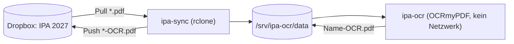

# ipa-projekte

Werkzeuge rund um die IPA-Eingaben (individuelle Produktivarbeit, Mediamatiker/in EFZ).

Aktuell enthalten: ein **lokaler OCR-Dienst**, der Eingaben ohne Textebene in durchsuchbare PDFs umwandelt. Die Verarbeitung läuft vollständig auf einem **privat betriebenen Server in der Schweiz**. Eingaben enthalten Betriebsinterna und Personendaten und gehören nicht zu externen Diensten.

## Datenverarbeitung und Standort

- **Privater Server in der Schweiz:** Die gesamte OCR-Verarbeitung läuft auf einem privat betriebenen Server in der Schweiz.
- **Keine Drittdienste für die Umwandlung:** Kein Cloud-OCR, kein Online-Konverter, kein Upload der Inhalte zu externen Anbietern.
- **Kein Netzwerk beim Verarbeiten:** Der OCR-Container läuft mit `network_mode: none` und kann keine Daten versenden.
- **Keine zusätzlichen Kopien:** Der Dienst legt Daten nur auf dem eigenen Server und im bestehenden Dropbox-Ordner ab. Die einzige Verbindung nach aussen ist `ipa-sync` zwischen Server und diesem Ordner.
- **Dropbox:** Der Speicherort der Dropbox-Daten hängt vom Dropbox-Konto ab und gehört nicht zu diesem Dienst. Wer Daten ausschliesslich in der Schweiz oder der EU halten muss, prüft den Speicherort des Kontos beim Anbieter.

## Das Problem

Einzelne Eingaben liegen als Bild-Scan vor. Ohne Textebene lassen sie sich weder automatisch vorprüfen noch durchsuchen. Online-Konverter scheiden aus Vertraulichkeitsgründen aus.

## Die Lösung

Zwei Docker-Container teilen sich ein Arbeitsverzeichnis, ein dritter zeigt das Log:



- **`ipa-sync`** zieht PDFs aus Dropbox und lädt fertige `-OCR.pdf` zurück. Nur dieser Container hat Netzwerkzugriff.
- **`ipa-ocr`** erkennt Seiten ohne Text und erzeugt `Originalname-OCR.pdf` im selben Ordner. Der Container läuft mit `network_mode: none`.
- **`ipa-log`** folgt dem OCR-Log, damit es in Portainer sichtbar ist.

## Eigenschaften

- **Vertraulich:** Der OCR-Container hat keine Netzwerkverbindung, nachweisbar mit `docker inspect`.
- **Originale bleiben unverändert:** Das Ergebnis erhält den Zusatz `-OCR`. Zwischenstände heissen `.part.pdf` und tragen nie den Zielnamen.
- **Gemischte PDFs:** Die Erkennung arbeitet pro Seite. Seiten mit vorhandenem Text bleiben unberührt (`--skip-text`).
- **Deutsch:** Tesseract mit `deu` und `eng`, Schweizer Schreibung.
- **Läuft unbeaufsichtigt:** Schleifen im Abstand von 5 Minuten (OCR) und 10 Minuten (Sync), Neustart nach Ausfall, Healthcheck für die Übersicht.

## Inhalt

| Pfad | Zweck |
| --- | --- |
| [`ocr/`](ocr/) | OCR-Dienst: Dockerfile, Verarbeitungsschleife, Compose-Stack, Beispielkonfiguration |
| [`ocr/README.md`](ocr/README.md) | Einrichtung, Betrieb, Stolpersteine, offene Punkte |

## Schnellstart

```bash
sudo mkdir -p /srv/ipa-ocr/{build,data,logs,rclone}
cp ocr/Dockerfile ocr/ocr-loop.sh /srv/ipa-ocr/build/
cd /srv/ipa-ocr/build && sudo docker build -t ipa-ocr:3 .
```

Danach rclone für Dropbox einrichten (`ocr/rclone.conf.example`) und `ocr/compose.yml` als Stack deployen. Die ausführliche Anleitung steht in [`ocr/README.md`](ocr/README.md).

## Hinweise

- `rclone.conf` enthält einen Token mit Zugriff auf die gesamte Dropbox. Die Datei gehört nie ins Repository und ist in `.gitignore` eingetragen.
- Lokale Kopien der Eingaben auf dem Gerät sind selbst eine Verarbeitung von Personen- und Betriebsdaten. Vor dem Produktivbetrieb Zulässigkeit und Datenträgerverschlüsselung klären.
